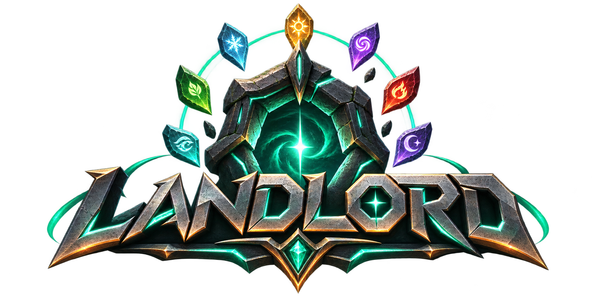

  

  # LANDLORD

  **Petualangan fantasi 3D di tujuh dunia.**

## Tentang LANDLORD

**LANDLORD** adalah permainan petualangan 3D berbasis browser yang mengajak pemain menjelajahi tujuh dunia fantasi dengan lingkungan, makhluk, dan tantangan yang beragam. Pemain dapat bertarung, memanfaatkan kemampuan karakter, menemukan jalur tersembunyi, serta melewati gerbang untuk melanjutkan perjalanan ke dunia berikutnya.

Permainan dirancang dengan pendekatan eksplorasi bebas. Checkpoint membantu perkembangan kemampuan dan perjalanan karakter, tetapi pemain tetap memiliki kebebasan untuk menentukan cara mencapai tujuan akhir.

LANDLORD dikembangkan menggunakan **JavaScript, HTML, dan CSS** untuk pengalaman bermain melalui browser pada komputer maupun perangkat seluler.

## Pengembang

Dikembangkan oleh **Lamberth Rumpaidus**.

**[GitHub — lamberthrumpaidus](https://github.com/lamberthrumpaidus)**
